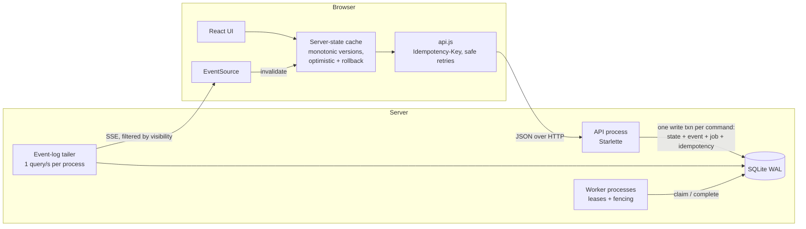

# OpsDesk — operational work coordination

[](https://github.com/deXter-star1/opsdesk/actions/workflows/ci.yml)

An internal web app that replaces "chat + spreadsheets + email" for operational requests: customer issues,
engineering problems, payment investigations, incidents, compliance requests and approval-gated tasks.

Every work item has a clear **owner**, **state**, **priority**, **deadline** and **full history**, and the
system is built to stay correct when many people act on the same item at the same time.

* `ENGINEERING_DECISIONS.md` — the six decisions that shape the system, with trade-offs.
* This file — how to run it, how it works, what to look at, and what is missing.

---

## Quick start

**Prerequisites:** Python 3.11+ (CI tests 3.11, 3.13 and 3.14 on Linux, macOS and Windows). Node 20+ only if you want to rebuild the frontend —
a pre-built bundle is committed in `frontend/dist/`.

```bash
pip install -r backend/requirements.txt     # starlette, uvicorn, pydantic
python run.py                               # migrate, seed 40k items, start API + worker
```

Open **http://localhost:8000** and click a demo account (all passwords: `demo1234`).
If port 8000 is already taken ("address already in use"), run `python run.py --port 8001` and open
http://localhost:8001 instead.

| Account | Roles | Good for |
|---|---|---|
| Priya Sharma | Support **lead**, Engineering member | dashboard, assigning |
| Rahul Verma | Support member | everyday member view |
| Meera Iyer | Payments **lead** | approving payments |
| Arjun Nair | Payments + Support member | owner of a payment awaiting approval |
| Kabir Singh / Neha Kulkarni | Eng lead + SRE member / SRE lead + Eng member | claim race on the P1 incident |
| Vikram Rao | Compliance **lead**, Payments viewer | approvals; read-only in Payments |
| Isha Patel | Support viewer, Compliance member | viewer restrictions |
| Sam Thomas | no team | can only raise and follow requests |
| Asha Admin | admin, Ops lead | **Background jobs** page |

Useful flags: `python run.py --reset` (fresh data), `--items 3000` (small dataset), `--port 8001` (another port),
`--failure-rate 0.3` (worker randomly fails 30% of jobs so you can watch retries and dead-lettering).

<details>
<summary>Running the pieces by hand</summary>

```bash
cd backend
python -m app.seed --reset                 # or: python -m app.migrate (schema only)
uvicorn app.main:app --port 8000           # API + serves frontend/dist
python -m app.worker                       # background jobs (run one or several)

cd frontend && npm install && npm run build   # rebuild UI (npm run dev = watch mode)
```

| Env var | Default | Meaning |
|---|---|---|
| `OPSDESK_DB` | `backend/data/opsdesk.db` | SQLite database file |
| `OPSDESK_JOB_FAILURE_RATE` | `0` | Probability a job handler fails on purpose |
| `OPSDESK_REALTIME_POLL_SECONDS` | `1.0` | How often each API process tails the event log |
| `OPSDESK_JOB_LEASE_SECONDS` | `30` | Job lease length before another worker may take it |
| `OPSDESK_STALE_AFTER_HOURS` | `72` | "Going stale" threshold |
| `OPSDESK_COOKIE_SECURE` | `0` | Set `1` behind HTTPS |
</details>

## Tests

```bash
cd backend  && python -m unittest discover -s tests -t tests -v   # 51 tests, ~4s, real SQLite + live HTTP server
#           (or: pytest)
cd frontend && npm test                                            # 11 tests, node:test, no extra deps
```

GitHub Actions (`.github/workflows/ci.yml`) runs on every push: the backend suite on Linux, macOS and
Windows with Python 3.11, 3.13 and 3.14; the frontend tests plus a check that the committed bundle matches
its source; and a start-up check on each OS that launches `python run.py`, logs in as a demo user, lists
items, waits for the worker to complete a job and (on macOS and Linux) checks that Ctrl+C shuts everything down.

Tests target the behaviours that would be dangerous if wrong, not coverage:

| Risk | Tests |
|---|---|
| Two people own the same work; two leads approve the same thing | `test_concurrency.py` — 12 threads racing `claim`, concurrent approvals, the same race over real HTTP |
| A write based on an old read silently wins | `test_concurrency.py::VersionGuardTests` — forces the READ COMMITTED interleaving and checks the version guard refuses |
| Lost updates when editing | `test_stale_data.py` — disjoint edits merge, overlapping edits 409 with both sides, stale transitions refused |
| Retried requests double-apply | `test_idempotency.py` — sequential and concurrent replays, key reuse with a different body, failures not cached |
| Data leaks across teams; UI-only enforcement | `test_authorization.py` — 404 on other teams' items in detail/list/search/stream, viewer API calls refused, separation of duties |
| Impossible states; history disagreeing with state | `test_workflow.py` — exhaustive status × action table, approval lifecycle, version ↔ event integrity, failed command leaves no trace |
| Lost, invented or duplicated notifications; zombie workers | `test_jobs.py` — outbox atomicity, at-least-once redelivery, retries/backoff/dead-letter, lease fencing, one SLA breach per item |
| Pages that skip or repeat rows; hostile search input | `test_queries.py` — keyset pagination with heavy ties for every sort, FTS injection, tiles match their lists |
| Client shows stale or speculative data as truth | `frontend/tests` — late responses never overwrite newer versions, optimistic rollback, conflict merge helpers |

---

## Architecture



**A command** (e.g. *Approve*) is one transaction: read the item → `policy.check_transition` (role,
state, separation of duties) → compare `expected_version` → `UPDATE … WHERE id = ? AND version = ?` →
append `item_events` row → enqueue `fanout_notifications` job → store the idempotency response → commit.
Either all of it happened or none of it did.

**Afterwards, asynchronously:** a worker leases the job, computes recipients (watchers, leads, assignee),
inserts notifications idempotently and completes the job in the same transaction. Each API process tails
`item_events`, pushes small "item 42 is now v7" hints to subscribed browsers over SSE, and those browsers
refetch through the normal authorized API.

### Data model

| Table | Purpose |
|---|---|
| `work_items` | Current state. `version` = optimistic-concurrency token; `active` generated column; FTS5 index on title/description |
| `item_events` | Append-only history (field diffs, transitions, comments, SLA flags). `item_version` links an event to the version it produced |
| `teams`, `memberships` | Many-to-many with a per-team role: viewer / member / lead |
| `item_watchers`, `notifications` | Who follows what; in-app inbox. `UNIQUE(event_id, user_id)` makes fan-out idempotent |
| `jobs` | Durable queue / outbox: status, attempts, `run_at` backoff, lease owner + expiry, `dedupe_key` |
| `idempotency_keys` | `(user_id, key)` → request fingerprint + stored response |
| `sessions` | sha256 of session tokens (HttpOnly cookie) |

### Workflow

```
open ─start/claim─▶ in_progress ─resolve─▶ resolved ─reopen─▶ open
                    │   ▲  ▲
               block│   │unblock / reject
                    ▼   │  │
                 blocked   awaiting_approval ◀─submit_for_approval─ in_progress
                           └─approve─▶ approved ─resolve─▶ resolved
any active state ─cancel─▶ cancelled
```

Payment and compliance items require approval by default (only a lead can waive it). An approver can never
be the item's owner or the person who requested approval. Ownership is frozen while approval is pending.

### Authorization

* Roles are **per team**. Visibility is **per resource**: you see an item if you are in its team (any role)
  *or you reported it* — so Support can raise a request in Payments' queue and follow it without seeing the
  rest of Payments.
* `backend/app/domain/policy.py` is the single source of truth. Every command calls it on the current row;
  the API also returns `allowed_actions` (computed by the same checks) so the UI can hide buttons.
  Hiding is cosmetic — `test_authorization.py` calls the API directly to prove it.
* Items you cannot see return **404, not 403**, in detail, history, list, search and the live stream.

### API

| Method | Path | Notes |
|---|---|---|
| POST | `/api/auth/login`, `/api/auth/logout` | HttpOnly SameSite=Lax cookie |
| GET | `/api/me`, `/api/teams`, `/api/teams/{id}/members` | |
| GET | `/api/dashboard` | six "needs attention" tiles + recent activity |
| GET | `/api/items` | `q`, `view`, `team`, `status`, `priority`, `kind`, `assignee`, `state`, `sort`, `cursor`, `limit` |
| POST | `/api/items` | create (Idempotency-Key supported on all mutations) |
| GET / PATCH | `/api/items/{id}` | PATCH = `{expected_version, changes}`; auto-merge or 409 `edit_conflict` |
| POST | `/api/items/{id}/claim` · `/assign` · `/transitions` · `/move` · `/comments` | `expected_version` on decisions |
| PUT / DELETE | `/api/items/{id}/watch` | |
| GET | `/api/items/{id}/events?before=` | paginated history |
| GET / POST | `/api/notifications`, `/api/notifications/read` | |
| GET | `/api/stream` | Server-Sent Events; resumes with `Last-Event-ID` |
| GET / POST | `/api/admin/jobs`, `/api/admin/jobs/{id}/retry` | admins only |

Errors are always `{"error": {"code", "message", "details"}}`; 409s carry the current item so the client
can show the user what changed instead of a generic failure.

---

## Five-minute demo of the critical behaviours

1. **Claim race.** Open two browsers (one private window) as **Neha** and **Kabir**. Both open
   *"Checkout API returning 502…"* and click **Claim** together. One gets "You own this now"; the other sees
   their optimistic "you own it" replaced by the real owner, e.g. "Neha Kulkarni claimed this a moment before you".
2. **Live updates.** Comment as Neha; Kabir's page shows it within ~1s, with a banner naming who changed what.
3. **Edit conflicts.** Both click **Edit**. Neha changes the title and saves. Kabir (whose draft is untouched,
   with a "this changed since you started" banner) changes the title too and saves → conflict dialog with
   *your edit vs current value*. Repeat with different fields (priority vs description): it merges silently.
4. **Approval rules.** As **Meera** open *Approvals* → approve Arjun's refund. As **Arjun**, there is no
   Approve button on his own item — and the API refuses it too (`separation_of_duties`).
5. **"Did my click work?"** As Arjun, tick **Simulate flaky network** in the sidebar and post a comment.
   The first response is dropped after the server processed it; the client retries with the same
   Idempotency-Key; the server replays; exactly one comment exists.
6. **Background failures.** `python run.py --failure-rate 0.5`, do a few actions, open **Background jobs**
   as Asha: jobs retry with backoff, some dead-letter, **Retry** re-queues them. Notifications still arrive
   exactly once.
7. **Scale.** Search "refund", sort by due date, click *Load more* repeatedly — 40k items, ~170k events.

## Performance

`python backend/scripts/bench_queries.py` on the seeded dataset (40,005 items, 11.8k active, 173k events),
a small development VM:

| Query | Time |
|---|---|
| default list, any sort, page 1 or page N (keyset) | 0.4–2 ms |
| full-text search ("refund", all states) | ~2–5 ms |
| dashboard (6 tiles with capped counts + activity feed) | ~6–16 ms warm; 40–190 ms on a cold cache |

"Cold" means the first queries after the database file has sat idle long enough for the OS to evict it from
memory; once pages are cached the warm figures apply. List queries are fast in both cases.

Indexes are shaped around the actual queries (`backend/app/migrations/001_initial.sql`). Nothing loads the
whole dataset: lists are keyset-paginated, counts are capped at 1,000 ("999+"), history is paginated.

---

## Project layout

```
run.py                      one-command launcher
backend/app/
  domain/workflow.py        state machine (data, no I/O)
  domain/policy.py          ALL authorization + workflow rules; allowed_actions for the UI
  services/items.py         commands: create, edit (merge/conflict), claim, assign, transition, move, comment
  services/queries.py       lists (keyset), search (FTS5), dashboard, history
  services/idempotency.py   Idempotency-Key handling inside the command transaction
  services/notifications.py recipients + idempotent fan-out
  jobs/queue.py             outbox queue: enqueue, lease, fenced complete, backoff, dead-letter
  jobs/handlers.py          fanout_notifications, sla_sweep, maintenance
  worker.py                 worker loop + periodic scheduling (dedupe per time window)
  realtime.py               event-log tailer + SSE with visibility filtering and Last-Event-ID replay
  http.py, routes.py        thin HTTP layer: query() = read snapshot, command() = one write txn
  migrations/001_initial.sql schema and indexes
backend/tests/              risk-focused tests (see table above)
frontend/src/
  lib/queryCache.js         server-state cache (versions, optimistic, invalidation)
  lib/api.js                fetch wrapper, idempotency keys, retries, flaky-network simulation
  lib/itemMutations.js      every item mutation and how its result/failure is reconciled
  lib/realtime.js           SSE → cache invalidation
  logic/items.js            pure reconciliation helpers (tested)
  pages/, components/       UI
```

## Known limitations

* **SQLite = one machine.** WAL gives many concurrent readers but one writer at a time, and the API and
  workers must share a disk. Write transactions are short (≈1 ms) so this comfortably serves an internal
  tool at the stated scale, but it is the first thing to change for multi-host deployment. The code is
  written to make that move mechanical — see ENGINEERING_DECISIONS.md §1.
* **Realtime is per-process polling (1 s).** Gap-free only because SQLite commits in id order; Postgres would
  need LISTEN/NOTIFY or commit-ordered tailing. A subscriber's team list is fixed at connect time, so a role
  change applies to the stream on reconnect (the API itself checks roles on every request).
* **No admin UI for teams/memberships** — they come from the seed. Authorization reads them fresh per request.
* **Notifications are in-app only.** The queue is designed for email/Slack delivery (idempotent handlers,
  retries), but no external channel is wired up.
* **Auth is deliberately simple:** email + password, no SSO, no login rate limiting, no password reset.
* **Search** is word-prefix full-text over title and description; no fuzzy matching, no comment search,
  and results are filtered (not relevance-ranked) so pagination stays stable.
* **Comments can't be edited or deleted** (append-only history by design; a correction is a new comment).
* **The list page does not auto-reorder** on others' changes; it offers "N updates · Refresh" instead.
* Frontend is plain JavaScript (no TypeScript). Its state logic has unit tests; the demo flows above are
  covered by a Playwright smoke script (`frontend/e2e/smoke.cjs`) that is not wired into CI.

## If this grew significantly

1. PostgreSQL with `SELECT … FOR UPDATE` (or keep the version guard), `FOR UPDATE SKIP LOCKED` job claims,
   LISTEN/NOTIFY to wake the stream, connection pooling; API processes become stateless and horizontally scaled.
2. Partition `item_events` by month; archive closed items out of the hot table; materialized dashboard counts.
3. Move search to a dedicated index (OpenSearch / Postgres trigram + tsvector) fed from the event log.
4. External notification channels (email, Slack) as additional job kinds, with per-user preferences and digests.
5. SSO (OIDC), audit export, admin UI for teams/roles, per-team workflow and SLA configuration.

## With another week

* Team & membership management with its own audit trail; per-team SLA policies.
* Bulk triage (multi-select assign/priority) using the same per-item version checks.
* @mentions with enrichment in the worker; saved views; email digests for stale work.
* Playwright end-to-end tests in CI covering the demo flows above; load test of concurrent claims via HTTP.
