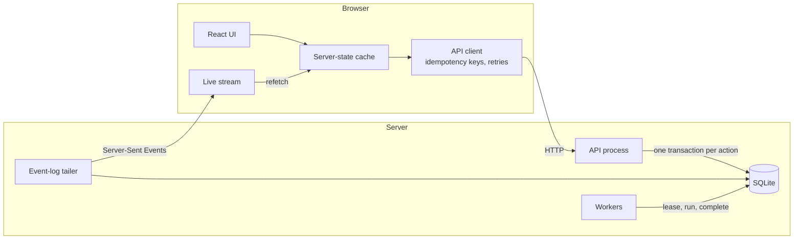

# OpsDesk

[](https://github.com/deXter-star1/opsdesk/actions/workflows/ci.yml)

A web app for coordinating operational work across teams: customer issues, incidents, payment
investigations, compliance requests and approvals. Every item has one owner, a clear state and a full
history, and the system stays correct when many people act on the same item at once.

Built for the Newtonite engineering challenge.

- **[ENGINEERING_DECISIONS.md](ENGINEERING_DECISIONS.md)**: the six decisions that shape the system, and their trade-offs
- **[docs/ARCHITECTURE.md](docs/ARCHITECTURE.md)**: data model, workflow, API, file layout and settings

## What it handles

- **Two people claim the same item at once.** Exactly one wins; the other is told who did.
- **Someone saves from an out-of-date screen.** Edits to different fields merge; clashing edits show both
  versions; approvals and status changes based on stale data are refused.
- **A request is retried after its response was lost.** The server recognises the retry and does the work once.
- **Background work fails, crashes or runs twice.** Jobs retry with backoff, end up in a dead-letter list
  if they keep failing, and never notify anyone twice.
- **People see only their own teams' work.** The API enforces this on every request; hiding buttons is not the protection.
- **Changes appear live** on everyone else's screen within about a second.
- **Tens of thousands of items.** Every list is paginated in the database; nothing loads the whole dataset.

## Run it

You need Python 3.11 or newer. Node is not needed: the built frontend is committed.

```bash
python3 -m venv .venv
source .venv/bin/activate
pip install -r backend/requirements.txt
python run.py
```

On Windows, use `python -m venv .venv` and activate with `.venv\Scripts\activate`.

The first start creates 40,000 demo items, which takes about a minute. Then open **http://localhost:8000**
and pick a demo account. The password for every account is `demo1234`.

| Option | Effect |
|---|---|
| `python run.py --reset` | Wipe and recreate the demo data |
| `--items 3000` | Smaller dataset, faster start |
| `--port 8001` | Use another port, if 8000 is taken ("address already in use") |
| `--failure-rate 0.3` | Make 30% of background jobs fail, to watch retries |

### Demo accounts

| Account | Teams and role | Use it to |
|---|---|---|
| Priya Sharma | Support lead, Engineering member | See the dashboard and assign work |
| Rahul Verma | Support member | See the everyday member view |
| Meera Iyer | Payments lead | Approve payments |
| Arjun Nair | Payments and Support member | Own a payment that is awaiting approval |
| Kabir Singh, Neha Kulkarni | Engineering and SRE | Race to claim the P1 incident |
| Vikram Rao | Compliance lead, Payments viewer | Approve compliance work; read-only in Payments |
| Isha Patel | Support viewer, Compliance member | See viewer restrictions |
| Sam Thomas | No team | Raise and follow requests only |
| Asha Admin | Admin, Ops lead | Open the **Background jobs** page |

## Try the critical behaviours

Use a normal window and a private window to be two people at once.

1. **Claim race.** As Neha and Kabir, open *Checkout API returning 502…* and click **Claim** in both at the
   same moment. One wins; the other screen switches to show the real owner.
2. **Live updates.** Comment as Neha. It appears on Kabir's page within a second.
3. **Edit conflicts.** Both click **Edit** and change the title. The second to save sees both versions and
   chooses. Change different fields instead, and the edits merge.
4. **Approval rules.** As Meera, approve Arjun's refund from **Approvals**. Arjun has no Approve button on
   his own item, and the API refuses the request if he sends it anyway.
5. **Lost response.** As Arjun, tick **Simulate flaky network** and post a comment. The first response is
   dropped and the request retried; exactly one comment appears.
6. **Failing jobs.** Start with `python run.py --failure-rate 0.5`, make a few changes, then open
   **Background jobs** as Asha to see retries, dead-lettered jobs and the **Retry** button.
7. **Scale.** Search for "refund", sort by due date and keep clicking **Load more**.

## Tests

```bash
cd backend
python -m unittest discover -s tests -t tests -v
```

51 tests, about 4 seconds, against a real SQLite database and a live HTTP server. The frontend has 11 more:
`cd frontend && npm test`.

GitHub Actions runs the backend tests on Linux, macOS and Windows with Python 3.11, 3.13 and 3.14, plus the
frontend tests and a start-up check of `run.py` on each operating system.

The tests target what would be dangerous if it went wrong:

| Risk | Tests |
|---|---|
| Two people own or approve the same thing | `test_concurrency.py` |
| A write based on an old read wins | `test_concurrency.py` (version guard) |
| Edits overwrite each other | `test_stale_data.py` |
| A retried request applies twice | `test_idempotency.py` |
| Data leaks across teams | `test_authorization.py` |
| Impossible states, or history out of step with state | `test_workflow.py` |
| Notifications lost or duplicated; crashed workers | `test_jobs.py` |
| Pages skip or repeat rows; hostile search input | `test_queries.py` |
| The browser shows stale data as current | `frontend/tests/` |

## How it works



- **One transaction per action.** Approving an item checks permissions on the current row, checks the
  version the user was looking at, updates with `WHERE version = ?`, records the history event, queues the
  notification job and stores the response for retries. All of it commits together, or none of it does.
- **Background work runs afterwards.** Workers lease jobs from the same database. A crashed worker's job is
  picked up again, and a slow worker cannot complete a job someone else has taken over.
- **Live updates are hints.** Each API process reads new history events once a second and tells browsers
  "item 42 is now at version 7". The browser refetches through the normal API, so permissions are checked in
  one place.
- **Permissions live in one module**, `backend/app/domain/policy.py`: per-team roles, plus visibility for
  whoever reported an item. Items you can't see return 404.

List pages take 0.4–2 ms and search 2–5 ms on 40,000 items. Details in
[docs/ARCHITECTURE.md](docs/ARCHITECTURE.md#performance).

## Known limitations

- **One machine.** SQLite allows one writer at a time, and the API and workers share a disk. That is enough
  at this scale; PostgreSQL is the first change for running on several servers.
- **Live updates arrive up to about a second late**, because each API process polls. A permission change
  reaches an open live stream when it reconnects; the API itself re-checks permissions on every request.
- **Teams and memberships come from the demo data.** There is no screen to manage them.
- **Notifications are in-app only.** No email or Slack.
- **Sign-in is basic.** No single sign-on, password reset or login rate limiting.
- **Search matches word prefixes** in titles and descriptions. No fuzzy matching, and comments aren't searched.
- **Comments can't be edited or deleted**, because history is append-only. A correction is a new comment.
- **The list page doesn't reorder itself** when others change items; it offers a refresh instead.
- **The browser test isn't run in CI.** `frontend/e2e/smoke.cjs` covers the demo flows above and is run by hand.
- **The frontend is plain JavaScript**, not TypeScript.

## Next steps

**With another week:**

- Team and membership management, with its own audit trail and per-team SLA rules
- Bulk triage: assign or reprioritise many items at once, with the same per-item version checks
- @mentions, saved views and email digests of stale work
- The browser test in CI, and a load test of concurrent claims over HTTP

**At a much larger scale:**

- PostgreSQL with `FOR UPDATE SKIP LOCKED` job claims and LISTEN/NOTIFY for live updates, so API servers
  can scale out
- History partitioned by month, closed items archived, dashboard counts precomputed
- A dedicated search index fed from the event log
- Email and Slack notifications, single sign-on, and per-team workflow settings
