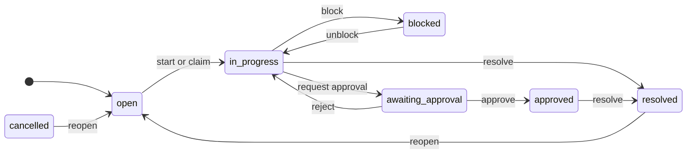

# OpsDesk architecture

Reference detail behind the [README](../README.md). The reasoning and trade-offs behind these choices are in
[ENGINEERING_DECISIONS.md](../ENGINEERING_DECISIONS.md).

## Contents

- [Request lifecycle](#request-lifecycle)
- [Data model](#data-model)
- [Workflow](#workflow)
- [Authorization](#authorization)
- [API](#api)
- [Project layout](#project-layout)
- [Running the pieces by hand](#running-the-pieces-by-hand), including [hosting](#hosting)
- [Performance](#performance)

## Request lifecycle

**A command** (for example *Approve*) is one database transaction:

1. Read the item.
2. `policy.check_transition`: role, current state, separation of duties.
3. Compare the client's `expected_version` with the current version.
4. `UPDATE work_items … WHERE id = ? AND version = ?`
5. Append an `item_events` row.
6. Enqueue a `fanout_notifications` job.
7. Store the response under the request's Idempotency-Key.
8. Commit. Either all of it happened or none of it did.

**Afterwards, asynchronously:** a worker leases the job, works out the recipients (watchers, leads,
assignee), inserts notifications idempotently and completes the job in the same transaction. Each API process
tails `item_events` and pushes small "item 42 is now v7" hints to subscribed browsers over Server-Sent
Events; the browsers refetch through the normal, authorized API.

## Data model

| Table | Purpose |
|---|---|
| `work_items` | Current state. `version` is the optimistic-concurrency token; `active` is a generated column; FTS5 index on title and description |
| `item_events` | Append-only history: field diffs, transitions, comments, SLA flags. `item_version` links an event to the version it produced |
| `teams`, `memberships` | Many-to-many with a per-team role: viewer, member or lead |
| `item_watchers`, `notifications` | Who follows what, and the in-app inbox. `UNIQUE(event_id, user_id)` makes fan-out idempotent |
| `jobs` | Durable queue and outbox: status, attempts, `run_at` backoff, lease owner and expiry, `dedupe_key` |
| `idempotency_keys` | `(user_id, key)` → request fingerprint and stored response |
| `sessions` | SHA-256 of session tokens (HttpOnly cookie) |

Schema and indexes: `backend/app/migrations/001_initial.sql`.

## Workflow



- Any active state can be **cancelled** (by a lead or the reporter).
- Blocking, rejecting, resolving, cancelling and reopening require a note.
- Payment and compliance items **require approval** by default; only a lead can waive it. An item that
  requires approval can only be resolved after it is approved.
- An approver can never be the item's owner or the person who requested approval.
- Ownership is frozen while approval is pending.

Source of truth: `backend/app/domain/workflow.py` (states and transitions) and `backend/app/domain/policy.py`
(who may perform each one).

## Authorization

- Roles are **per team**: viewer < member < lead.
- Visibility is **per item**: you see an item if you are in its team (any role) *or you reported it*. Support
  can raise a request in Payments' queue and follow it without seeing the rest of Payments.
- `backend/app/domain/policy.py` is the single source of truth. Every command calls it on the current row.
  The API also returns `allowed_actions`, computed by the same checks, so the UI can hide buttons. Hiding is
  cosmetic: `test_authorization.py` calls the API directly to prove the server refuses.
- Items you cannot see return **404, not 403**, in detail, history, lists, search and the live stream, so
  their existence doesn't leak.
- Sessions are server-side, so roles are re-read on every request and logout is immediate. Mutations also
  require a custom header as CSRF defence on top of SameSite=Lax cookies.

## API

| Method | Path | Notes |
|---|---|---|
| POST | `/api/auth/login`, `/api/auth/logout` | HttpOnly, SameSite=Lax cookie |
| GET | `/api/me`, `/api/teams`, `/api/teams/{id}/members` | |
| GET | `/api/dashboard` | Six "needs attention" tiles and recent activity |
| GET | `/api/items` | `q`, `view`, `team`, `status`, `priority`, `kind`, `assignee`, `state`, `sort`, `cursor`, `limit` |
| POST | `/api/items` | Create |
| GET, PATCH | `/api/items/{id}` | PATCH takes `{expected_version, changes}`; merges or returns 409 `edit_conflict` |
| POST | `/api/items/{id}/claim`, `/assign`, `/transitions`, `/move`, `/comments` | Decisions take `expected_version` |
| PUT, DELETE | `/api/items/{id}/watch` | |
| GET | `/api/items/{id}/events?before=` | Paginated history |
| GET, POST | `/api/notifications`, `/api/notifications/read` | |
| GET | `/api/stream` | Server-Sent Events; resumes with `Last-Event-ID` |
| GET, POST | `/api/admin/jobs`, `/api/admin/jobs/{id}/retry` | Admins only |

- Every mutation accepts an `Idempotency-Key` header.
- Errors are always `{"error": {"code", "message", "details"}}`.
- 409 responses carry the current item, so the client can show what changed instead of a generic failure.

## Project layout

```
run.py                        one-command launcher
backend/app/
  domain/workflow.py          state machine (data, no I/O)
  domain/policy.py            all authorization and workflow rules; allowed_actions for the UI
  services/items.py           commands: create, edit (merge or conflict), claim, assign, transition, move, comment
  services/queries.py         lists (keyset), search (FTS5), dashboard, history
  services/idempotency.py     Idempotency-Key handling inside the command transaction
  services/notifications.py   recipients and idempotent fan-out
  jobs/queue.py               outbox queue: enqueue, lease, fenced complete, backoff, dead-letter
  jobs/handlers.py            fanout_notifications, sla_sweep, maintenance
  worker.py                   worker loop and periodic scheduling (deduplicated per time window)
  realtime.py                 event-log tailer and SSE with visibility filtering and Last-Event-ID replay
  http.py, routes.py          thin HTTP layer: query() is a read snapshot, command() one write transaction
  migrations/001_initial.sql  schema and indexes
backend/tests/                risk-focused tests
backend/scripts/              query benchmark
frontend/src/
  lib/queryCache.js           server-state cache (versions, optimistic updates, invalidation)
  lib/api.js                  fetch wrapper, idempotency keys, retries, flaky-network simulation
  lib/itemMutations.js        every item mutation and how its result or failure is reconciled
  lib/realtime.js             SSE to cache invalidation
  logic/items.js              pure reconciliation helpers (unit tested)
  pages/, components/         UI
frontend/dist/                pre-built bundle, committed so the app runs without Node
frontend/e2e/smoke.cjs        Playwright browser test of the demo flows
.github/                      CI workflow and start-up check
```

## Running the pieces by hand

`run.py` does all of this for you. To run each process separately:

```bash
cd backend
python -m app.seed --reset
uvicorn app.main:app --port 8000
python -m app.worker
```

- `python -m app.migrate` creates the schema without seeding.
- Run several `app.worker` processes to see leases share the work.
- To rebuild the frontend: `cd frontend && npm install && npm run build`. Use `npm run dev` to rebuild on
  every change.

| Environment variable | Default | Meaning |
|---|---|---|
| `OPSDESK_DB` | `backend/data/opsdesk.db` | SQLite database file |
| `OPSDESK_JOB_FAILURE_RATE` | `0` | Probability a job handler fails on purpose |
| `OPSDESK_REALTIME_POLL_SECONDS` | `1.0` | How often each API process reads the event log |
| `OPSDESK_JOB_LEASE_SECONDS` | `30` | Job lease length before another worker may take it |
| `OPSDESK_STALE_AFTER_HOURS` | `72` | "Going stale" threshold |
| `OPSDESK_COOKIE_SECURE` | `0` | Set to `1` behind HTTPS |

### Hosting

`render.yaml` deploys the app to Render's free plan as a single web service:
`python run.py --host 0.0.0.0 --port $PORT` runs the API and the worker together. The free plan has no
persistent disk and sleeps after 15 minutes idle, so the demo data (8,000 items) is recreated on every start
and the first visit after a sleep takes about a minute. A real deployment would use a persistent disk or
PostgreSQL.

## Performance

`python backend/scripts/bench_queries.py` on the seeded dataset (40,005 items, 11.8k active, 173k events) on a
small development VM:

| Query | Time |
|---|---|
| Default list, any sort, page 1 or page N (keyset) | 0.4–2 ms |
| Full-text search ("refund", all states) | ~2–5 ms |
| Dashboard (6 tiles with capped counts and activity feed) | ~6–16 ms warm; 40–190 ms on a cold cache |

"Cold" means the first queries after the database file has been idle long enough for the operating system
to drop it from memory. Once it is cached again, the warm figures apply. List queries are fast either way.

Indexes are shaped around the actual queries. Nothing loads the whole dataset: lists use keyset pagination,
counts stop at 1,000 (shown as "999+"), and history is paginated.
